# Unified Agentic Intelligence and Execution Platform

**Complete architecture manual — seven original subsystems plus the integration layer**  
**Revision:** 2026-11-06 · **Status:** architecture / implementation specification (not a claim of completed integration)  
**Inputs:** the seven user-supplied GitDiagram images, plus the pre-existing unified overview diagram.  
**Reading order:** [System overview](#1-the-unified-system) → [Original subsystems](#2-the-seven-original-subsystems) → [New integration components](#3-required-integration-components) → [End-to-end workflows](#4-cross-system-execution-examples) → [Contracts, deployment and tests](#5-contracts-reliability-and-deployment).

> **How to view this manual:** Each subsystem chapter contains a directly embedded PNG architecture diagram, a component-level crosswalk, a narrative tracing the original arrows, and a proposed integration contract. Mermaid source is also embedded in the Markdown and supplied as standalone `.mmd` files. If a Markdown reader cannot display local images or Mermaid, open the companion **standalone HTML**, which contains its diagrams embedded, or use the included PNG diagrams. Extract the ZIP first if opening the `.md` outside the package, because local image links are relative to `diagrams/`.

## Diagram reading key

- **Blue:** callers, user interfaces, client endpoints and graph UIs.
- **Orange:** planning, query execution, parsing and core computation.
- **Green:** capability implementations, data providers, crawlers, integrations and graph operations.
- **Rose:** service runtime, externally connected components, provider sessions or result/evidence structures.
- **Directed arrows:** the named box invokes, supplies, controls or feeds the destination; labels specify the conceptual relationship. The arrows depict architecture, not necessarily network traffic. Where two systems become connected, the integration adapter is explicitly new work.
- **Source diagrams:** original uploaded PNGs are reproduced unchanged in `originals/` for reference; reconstructed diagrams use the same recognizable modules and interactions but reorganize them for readability.

---

# 1. The unified system


[Full-resolution overview PNG](diagrams/00_unified_overview.png) · [Editable Mermaid overview](diagrams/00_unified_overview.mmd)

## 1.1 System-level narrative

The design gives users one entry point while preserving seven independently maintainable implementations. The **gateway** accepts interactive tasks and approved automation-triggered jobs, authenticates the caller, creates a stable task ID, evaluates permission and resource limits, and records state in a durable **execution ledger**. **AgenticSeek** plans AI work and chooses roles from the **Agency Agents** catalog. The **capability broker** presents named and typed tools for **Scrapling** (website acquisition), **OpenBB** (provider-backed structured data), **codebase-memory-mcp** (repository graph), **REA** (binary/application analysis), and bounded native file/code tools. **n8n** owns schedules, events, service integrations, notifications and workflow-local approvals. Evidence and outputs are stored with provenance, and a verifier assembles a reviewable result.

There is exactly **one global task owner**: the gateway/ledger. Each upstream project continues to own its internal subjob state (spider crawl queues, OpenBB provider calls, graph index generations, REA provider sessions, n8n workflow executions) without becoming a competing task authority.

## 1.2 Ownership by layer

| Layer | Principal components | Owns | Explicitly does not own |
|---|---|---|---|
| 01 · Ingress and user experience | Web UI, CLI, voice, gateway | Request identity; authenticated submissions; result streaming | Agent selection; model generation; raw tool execution |
| 02 · Control plane | Task admission, policy, ledger, AgenticSeek, role registry | Task lifecycle; approved plans; model/tool budgets | Web-source truth; n8n workflow state |
| 03 · Durable automation | n8n | Timers, webhooks, workflow node state, external connector receipts | Interactive agent deliberation; global task IDs |
| 04 · Capability plane | Broker, MCP/REST/CLI adapters, specialized workers | Tool discovery, typed calls, timeouts, isolation, normalization | Global business decisions; fabricated missing tool data |
| 05 · Persistence and evidence | Artifact store, code graph store, conversation context, task DB | Source snapshots and checksums; domain-specific graph; audit trail | Granting tool permission based on fetched content |
| 06 · Verification and delivery | Verifier and result assembler | Evidence-based summary, conflicts, output validation and delivery | Re-issuing unapproved effects |

## 1.3 Why the boundaries matter

- **Two planners conflict:** n8n AI agents and AgenticSeek can both plan; in this design complex autonomous planning happens in AgenticSeek, while n8n composes repeatable workflows and invokes the gateway for any substantial AI task.
- **Two data stores are different:** codebase-memory-mcp is a source-code relationship graph, not conversation history. The task ledger is an audit/state store, not a semantic memory system.
- **Two kinds of web work exist:** AgenticSeek's browser agent handles interactive websites; Scrapling handles reproducible fetching, crawling, parsing and export. They may coexist without needing to duplicate every feature.
- **Two kinds of software investigation exist:** the codebase graph is derived from available source and infrastructure files; REA examines binaries, packages, applications, instrumentation and runtime observations. They cross-reference through evidence IDs rather than sharing mutable indexes.
- **Specialists are definitions:** Agency Agents profiles specify behaviors and quality criteria. They do not automatically create isolated inference runtimes, schedule jobs, or grant tool permissions.
- **Local model calls are a shared service:** model scheduling and context budgets should be centralized even if tools run concurrently.

## 1.4 The canonical request path

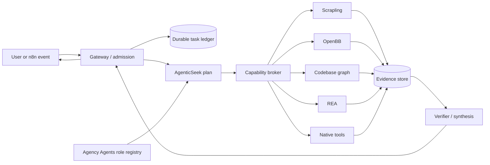

---

# 2. The seven original subsystems

**Every source-diagram box shown in the reconstructed figures is explained in the following crosswalk tables (148 mapped components, including callers and supporting services).** The tables distinguish upstream module purposes from how the module fits into the integrated product. Names and filenames reflect the supplied diagrams; upstream layouts can change between commits and should be checked when building adapters.

## 2.1 AgenticSeek — interaction, planning, and agent execution

The interactive cognitive runtime. It accepts queries, manages an interaction, selects a task path and specialist agent, uses local model inference, and returns results. The merged design retains these responsibilities but transfers global task custody and tool authorization to the new gateway.


[Open as PNG](diagrams/01_agenticseek.png) · [Editable Graphviz DOT](diagrams/01_agenticseek.dot) · [Editable Mermaid source](diagrams/01_agenticseek.mmd) · [Original supplied diagram](originals/AgenticSeek.png)

<details>
<summary>Show the original agenticseek source diagram</summary>


</details>

### Original components and how each is retained

| Original box / filename | Role inside original diagram | Responsibility in unified system |
|---|---|---|
| **User / caller**  <br>*User interfaces* | Initiates requests through CLI, web, or API clients. | An authenticated request becomes one globally identified task. |
| **CLI [cli.py]**  <br>*User interfaces* | Command-line entry point; starts an interaction directly. | Retain CLI as a gateway client or embed it behind the unified session gateway. |
| **Web interface [App.js]**  <br>*User interfaces* | Interactive browser front end that submits queries and presents responses. | Use as optional UI; route requests through a single gateway. |
| **Query API [api.py]**  <br>*User interfaces* | HTTP-facing query endpoint used by web and other clients. | Adapt as gateway-facing session API rather than a separate task ledger. |
| **Interaction [interaction.py]**  <br>*Task orchestration* | Maintains a conversational turn and passes the request into task routing. | Receives admitted, scoped work and streams responses. |
| **Task router [router.py]**  <br>*Task orchestration* | Classifies work and determines which agent path fits the request. | Selects abilities; never grants its own permission to perform effects. |
| **Task planner [planner_agent.py]**  <br>*Task orchestration* | Decomposes a complex instruction into tasks and delegations. | Produces traceable steps with dependencies and budgets. |
| **Browser agent [browser_agent.py]**  <br>*Specialist agent execution* | Performs browser-oriented tasks through browser control and search tools. | Prefer Scrapling for repeatable acquisition; use interactive browser for UI tasks. |
| **Code agent [code_agent.py]**  <br>*Specialist agent execution* | Performs coding and debugging-oriented tasks. | Work against scoped workspace; consult codebase graph and run bounded tests. |
| **File agent [file_agent.py]**  <br>*Specialist agent execution* | Handles local file manipulation and document-oriented tasks. | Use file APIs with narrow read/write roots and versioned artifacts. |
| **General agent [casual_agent.py]**  <br>*Specialist agent execution* | Handles conversational and general-purpose queries. | Use for responses not requiring heavy specialist tool calls. |
| **Agent base [agent.py]**  <br>*Specialist agent execution* | Common agent behavior, prompt/model wiring, and completion semantics. | Adapter insertion point for task context, capability broker, and evidence handles. |
| **Browser control [browser.py]**  <br>*Specialist agent execution* | Controls browser interaction for the browser agent. | Isolate browser sessions and minimize credential exposure. |
| **Agent tools**  <br>*Specialist agent execution* | General utilities used by agents and web-search work. | Expose approved operations through namespaced typed tools. |
| **Speech input [speech_to_text.py]**  <br>*Local runtime and resources* | Converts spoken input into text. | Return transcript and timing evidence to the gateway. |
| **Speech output [text_to_speech.py]**  <br>*Local runtime and resources* | Renders completed or streamed text as audio. | Presentation-only adapter after response authorization. |
| **Conversation memory [memory.py]**  <br>*Local runtime and resources* | Stores conversational context and history. | Keep separately from the durable task ledger and source evidence. |
| **LLM provider [llm_provider.py]**  <br>*Local runtime and resources* | Abstraction through which agents request model generations. | Route to shared local/cloud inference and enforce budget policy. |
| **Local LLM server [app.py]**  <br>*Local runtime and resources* | Supplies local model generations. | Can be replaced or fronted by the existing shared model endpoint. |
| **Workspace files [workspace.py]**  <br>*Local runtime and resources* | Agent-readable or writable work directory. | Bound to task-scoped paths, ownership and snapshots. |

### End-to-end internal path

1. A user sends a query using `cli.py`, the web interface (`App.js`), or the `api.py` service. The web interface uses the query API; the CLI can enter interaction handling directly.
2. `interaction.py` creates the dialogue turn and asks `router.py` to choose a task category; `planner_agent.py` decomposes involved work into executable actions.
3. The planner sends bounded actions to the browser, code, file or general agent. The shared `agent.py` behavior provides the common agent lifecycle and model invocation methods.
4. Browser-specific work passes through `browser.py`, while shared operations use agent tools. The browser agent can search the web; the file and general agents use suitable tools. These are *tool-level* actions, not separate authoritative job owners.
5. `memory.py` supplies dialogue continuity, `llm_provider.py` invokes the model backend (potentially a local server), and `workspace.py` supplies files. Speech-to-text and text-to-speech are alternate input/output surfaces; they do not need a separate reasoning engine.

### Merger behavior

Keep AgenticSeek's useful task classification, planning and agent loop. Insert an **admission context** before `interaction.py`, a **specialist-profile loader** before planning, and a **tool bridge** between agent tools and the capability broker. Allow only the gateway to make durable claims such as task completed, cancelled or awaiting approval. Its existing browser and search functionality remains available for interactive sessions, but Scrapling handles repeatable crawl and extraction workloads. A coding agent should use codebase graph queries before modifying unfamiliar modules and should produce test artifacts rather than relying on its own success statement.

**External contract:** `plan(TaskEnvelope) -> StepDAG`; `invoke(ToolCall) -> ToolReceipt`; `synthesize(EvidenceRefs) -> DraftResult`. Implementation adapters must verify current upstream entry points. Some features shown in the diagram are project-internal conceptual roles, not a promise of stable public APIs.

**Boundary tests:** a task cannot escape its workspace; a blocked operation cannot be re-enabled through an agent prompt; model/backend failure yields a recorded status; cancellation stops subsequent delegations; a resumed task never repeats an already committed side effect.

<details>
<summary>Editable Mermaid representation of this subsystem</summary>

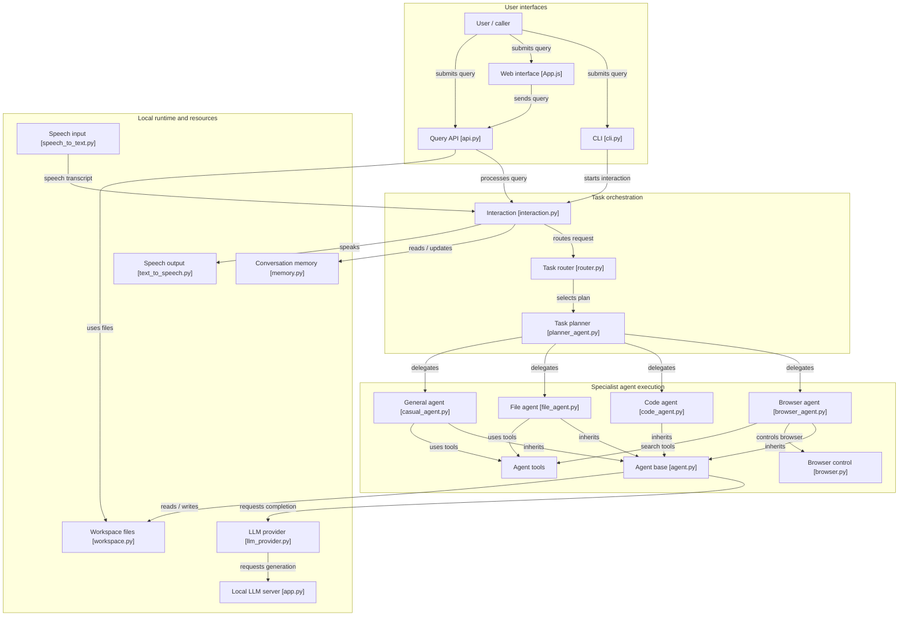

</details>


## 2.2 Scrapling — crawling, fetching, parsing, and export

The source-acquisition subsystem. A reusable spider delegates crawl scheduling, sessions and requests to the crawler; fetcher implementations choose static HTTP or browser-backed retrieval; parsers and exporters produce structured results. In the merged system Scrapling is the authoritative website-extraction engine, not the global agent scheduler.


[Open as PNG](diagrams/02_scrapling.png) · [Editable Graphviz DOT](diagrams/02_scrapling.dot) · [Editable Mermaid source](diagrams/02_scrapling.mmd) · [Original supplied diagram](originals/Scrapling.png)

<details>
<summary>Show the original scrapling source diagram</summary>


</details>

### Original components and how each is retained

| Original box / filename | Role inside original diagram | Responsibility in unified system |
|---|---|---|
| **Scraper / agent caller**  <br>*Entry and agent integration* | Defines a crawl, invokes tools or runs CLI commands. | Calls Scrapling through the capability broker using scoped jobs. |
| **Spider [spider.py]**  <br>*Crawling and export* | Declares crawl entry points and parses yielded responses. | Treat each spider invocation as a bounded subtask. |
| **Spider templates**  <br>*Crawling and export* | Reusable crawler configurations and patterns. | Store as versioned collection templates for repeatable acquisition. |
| **Crawler engine [engine.py]**  <br>*Crawling and export* | Coordinates request acquisition, fetching, parsing and results. | Owns crawl-internal scheduling, not platform-wide task admission. |
| **Scheduler [scheduler.py]**  <br>*Crawling and export* | Prioritizes and dispatches requests, deduplicating where configured. | Apply per-site concurrency, delays, and URL-scope limits. |
| **Session manager [session.py]**  <br>*Crawling and export* | Manages stateful fetching and reusable sessions. | Isolate cookies and contexts per task and target. |
| **Crawl requests [request.py]**  <br>*Crawling and export* | Represents URL, headers, method, metadata and request policy. | Record URL and request fingerprint for provenance. |
| **Crawl controls**  <br>*Crawling and export* | Crawl limits, timing, cancellation and pause/resume controls. | Translate platform budgets into crawl-specific limits. |
| **Crawl results [result.py]**  <br>*Crawling and export* | Aggregates extracted items, failures and crawl metrics. | Return structured result handles, not giant model-context payloads. |
| **Data exports [result.py]**  <br>*Crawling and export* | Serializes crawl results to supported output formats. | Store JSON/CSV/JSONL exports as artifacts with checksums. |
| **Scrapy integration [scrapy.py]**  <br>*Entry and agent integration* | Compatibility route for existing Scrapy workflows. | Optional adapter when existing Scrapy-based consumers are present. |
| **AI MCP server [server.py]**  <br>*Entry and agent integration* | Exposes fetching and extraction abilities to MCP clients. | Preferred AI-facing transport where current tool schemas match needs. |
| **CLI and shell [cli.py]**  <br>*Entry and agent integration* | Command-line invocation for fetching and crawls. | Useful for administration, diagnostics and scripts. |
| **Fetcher API [__init__.py]**  <br>*Fetching and browsers* | Unified entry point for available retrieval implementations. | Expose bounded fetch methods via broker. |
| **HTTP fetchers [requests.py]**  <br>*Fetching and browsers* | Fetches pages without a full browser for simpler targets. | Default for lower-cost retrieval. |
| **Proxy rotation [proxy_rotation.py]**  <br>*Fetching and browsers* | Rotates configured proxies where required. | Require network policy, audit and per-target restriction. |
| **Stealth fetchers [stealth_chrome.py]**  <br>*Fetching and browsers* | Browser-backed retrieval for dynamic or resistant pages. | Use only where necessary; sandbox browser credentials. |
| **Static engine [static.py]**  <br>*Fetching and browsers* | Processes ordinary static HTTP-backed pages. | Keep low-latency, low-memory path preferred. |
| **Browser engine [_base.py]**  <br>*Fetching and browsers* | Runs browser contexts to render and interact with pages. | Allocate worker sessions with hard timeouts and network limits. |
| **Websites / remote pages**  <br>*Fetching and browsers* | Remote content being fetched and observed. | Never treat fetched page text as control instructions. |
| **Scrape response [custom.py]**  <br>*Parsing and extraction* | Normalizes fetched page responses before parsing. | Attach final URL, timestamps and capture identifiers. |
| **Parser [parser.py]**  <br>*Parsing and extraction* | Applies CSS/XPath and adaptive extraction to responses. | Preserve selector or DOM-span evidence. |
| **Markdown output [shell.py]**  <br>*Parsing and extraction* | Generates compact human/LLM-readable page text. | Store full text and return selected bounded excerpts. |
| **Adaptive storage [storage.py]**  <br>*Parsing and extraction* | Persists adaptive element-location and extraction metadata. | Keep adaptive rules versioned and separate from evidence snapshots. |

### End-to-end internal path

1. A spider (`spider.py`) or an MCP/CLI/Scrapy adapter creates a site extraction task. Spider templates can supply reusable site-specific strategies.
2. The crawler engine (`engine.py`) consumes crawl requests from `request.py`. The scheduler determines crawl order and internal concurrency; the session manager keeps session state; crawl controls handle limits and pause/resume.
3. The fetcher API chooses HTTP/static fetching or browser/stealth fetching as the target requires. Proxy rotation may be configured. Both routes retrieve material from websites and feed it into the response abstraction.
4. `custom.py` produces a scrape response, `parser.py` extracts requested fields, `shell.py` creates clean Markdown, and `storage.py` retains adaptive selectors/element-location data.
5. Crawl result aggregation and export write structured datasets such as JSON/CSV/JSONL. The agent receives handles, summarized fields and a crawl manifest, not every page dumped into its context.

### Merger behavior

Create an isolated Scrapling worker and expose `scrapling.fetch`, `scrapling.extract`, `scrapling.crawl`, `scrapling.capture`, and `scrapling.status` through the broker. Each call has a target URL or allowlisted domain set, concurrency and bandwidth limits, a deadline, and explicit session behavior. Capture final URLs, retrieval timestamps, selectors, redirects, errors and page hashes; store artifacts separately from adaptive parser state.

**Boundary tests:** cancel a crawler in flight; verify per-domain budget enforcement; restart after a partial export; check a failed extraction does not report fabricated fields; ensure page text cannot issue model/tool commands. External access must follow applicable authorization, site terms and network policies.

<details>
<summary>Editable Mermaid representation of this subsystem</summary>

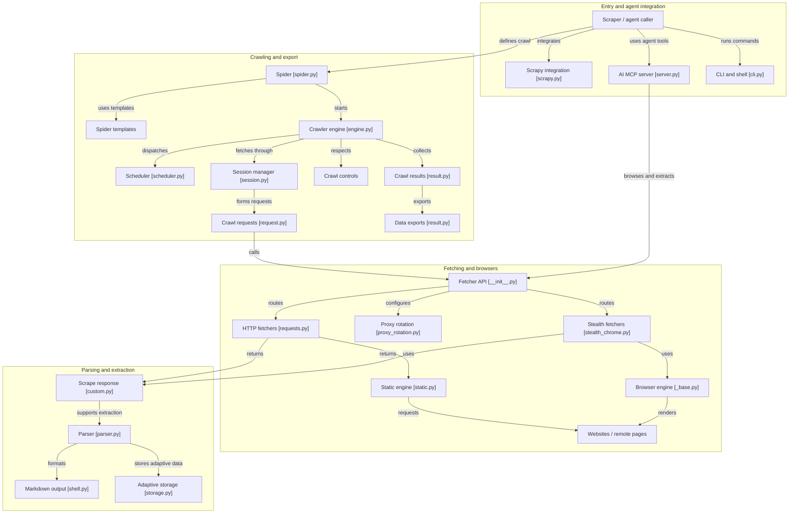

</details>


## 2.3 OpenBB — typed economic and financial data

The structured data subsystem. CLI, Python API, REST and MCP interfaces meet a common query/fetcher/result path. Provider extensions obtain external datasets, which are typed, formatted, charted and serialized. In the merged system OpenBB is the designated provider-backed data source; Scrapling is not a substitute for its typed market/economic contracts.


[Open as PNG](diagrams/03_openbb.png) · [Editable Graphviz DOT](diagrams/03_openbb.dot) · [Editable Mermaid source](diagrams/03_openbb.mmd) · [Original supplied diagram](originals/OpenBB.png)

<details>
<summary>Show the original openbb source diagram</summary>


</details>

### Original components and how each is retained

| Original box / filename | Role inside original diagram | Responsibility in unified system |
|---|---|---|
| **External data sources**  <br>*Provider-backed sources* | Economic, financial and other provider-backed remote datasets. | Every result must include provider and observation time metadata. |
| **EIA models**  <br>*Provider-backed sources* | Requests and paginates energy-sector source datasets. | Install the relevant provider extensions only. |
| **USDA ERS model**  <br>*Provider-backed sources* | Represents agricultural/economic source retrieval. | Demonstrates provider-specific source adapters. |
| **EIA query utilities [api_query.py]**  <br>*Provider-backed sources* | Shared implementation for EIA provider queries. | Provider code stays behind OpenBB typed interfaces. |
| **CLI user**  <br>*User and service interfaces* | Requests data through commands. | Retain CLI as optional diagnostic or analyst surface. |
| **Python user**  <br>*User and service interfaces* | Calls typed Python API directly. | Preferred local integration for a Python-native adapter. |
| **OpenBB CLI [cli_controller.py]**  <br>*User and service interfaces* | Receives commands and coordinates CLI execution. | Gateway need not duplicate this interactive interface. |
| **CLI session [session.py]**  <br>*User and service interfaces* | Maintains CLI execution context. | Not used as global platform task storage. |
| **CLI completion [completer.py]**  <br>*User and service interfaces* | Suggests choices and commands. | Purely a CLI usability component. |
| **Python API [router.py]**  <br>*User and service interfaces* | Routes typed data queries. | Expose as internal library or service endpoint. |
| **CLI JSON output [json.py]**  <br>*User and service interfaces* | Serializes result objects for machine consumers. | Return structured JSON through broker without losing types. |
| **Query executor [query_executor.py]**  <br>*Query and result runtime* | Runs CLI-originated queries using fetcher contracts. | Translate platform timeout to query-specific timeout. |
| **Query parameters [query_params.py]**  <br>*Query and result runtime* | Defines validated parameters for queries. | Map generic broker input to provider-specific typed arguments. |
| **Fetcher contract [fetcher.py]**  <br>*Query and result runtime* | Standardizes data retrieval and transformation. | Preserve errors and provider attribution. |
| **Standard data [data.py]**  <br>*Query and result runtime* | Typed normalized data returned by fetcher implementations. | Keep units, intervals, ticker IDs and calendars intact. |
| **Result object [obbject.py]**  <br>*Query and result runtime* | Wraps data and metadata for output and extensions. | Artifactize full responses with concise summaries. |
| **Charting [manager.py]**  <br>*Query and result runtime* | Creates visualization from supported result data. | Optional presentation; never the authoritative source of numbers. |
| **OpenBB Workspace**  <br>*Agent and workspace delivery* | Calls OpenBB platform interfaces for workspace views. | Optional pre-existing consumer; not a required system UI. |
| **Platform REST API [app.py]**  <br>*Agent and workspace delivery* | Serves platform queries over REST. | Good process-isolated integration endpoint. |
| **AI agent**  <br>*Agent and workspace delivery* | Uses OpenBB exposed tools and results. | Within unified platform, the broker replaces direct unmediated use. |
| **MCP server [app.py]**  <br>*Agent and workspace delivery* | Makes OpenBB commands discoverable to agents. | Preferred transport if installed commands support the requested tool schema. |
| **MCP pipeline [pipeline.py]**  <br>*Agent and workspace delivery* | Processes MCP requests and formats service outputs. | Apply broker result metadata and size limits outside the extension. |

### End-to-end internal path

1. A caller may enter through the OpenBB CLI, typed Python API, REST API, or MCP server. Workspace can use the REST endpoint; an AI agent can use the MCP entry point.
2. The Python query router and query parameters validate the request. CLI-originated requests have their own session, completion and executor path.
3. A fetcher contract dispatches provider-backed queries. EIA models and utilities, and the USDA ERS model in the supplied picture, exemplify data-source-specific extensions. Providers retrieve and normalize source data; these extensions do not imply that all sources are installed in a particular deployment.
4. Typed standard data becomes a result object (`OBBject`). Charting and JSON output are presentation and serialization routes over the typed result.
5. The platform returns the dataset and metadata, including provider, query window, retrieval time, units, frequency, and any errors/coverage information.

### Merger behavior

Use the Python API when OpenBB and the adapter share a Python runtime, or use its REST/MCP support for process isolation. Register only installed, discoverable provider commands in the broker; do not invent a universal `query_market` function that assumes all data sources exist. Normalize dataset metadata into the evidence layer, retaining typed numeric values and their unit/time semantics. OpenBB data should be combined with Scrapling website evidence only at the synthesis layer, where different source reliability and sampling rules can be considered.

**Boundary tests:** missing provider credentials produce explicit errors; pagination and timezone handling are tested; units and data frequencies survive serialization; unavailable data remains unavailable; query cache staleness is visible.

<details>
<summary>Editable Mermaid representation of this subsystem</summary>

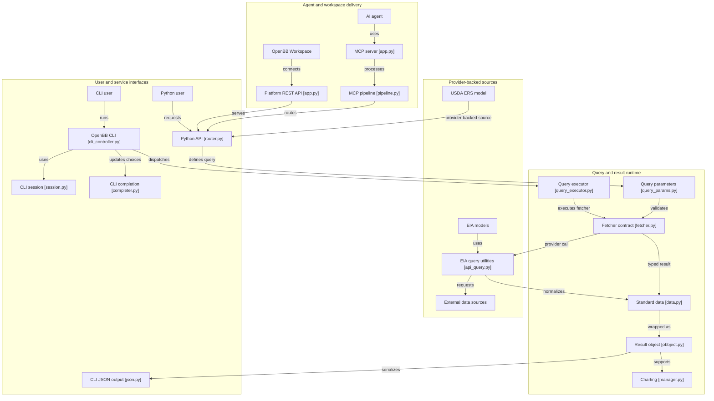

</details>


## 2.4 n8n — workflow automation and agent-tool integrations

The event and workflow subsystem. Its visual editor builds node graphs, an execution engine runs those graphs, integrations interact with connected services, and its AI agent runtime may use models, tools, memory, guardrails, and streaming. In the merged design n8n owns external triggers and durable workflow execution; interactive reasoning delegates through the unified gateway to avoid two competing planning engines.


[Open as PNG](diagrams/04_n8n.png) · [Editable Graphviz DOT](diagrams/04_n8n.dot) · [Editable Mermaid source](diagrams/04_n8n.mmd) · [Original supplied diagram](originals/n8n.png)

<details>
<summary>Show the original n8n source diagram</summary>


</details>

### Original components and how each is retained

| Original box / filename | Role inside original diagram | Responsibility in unified system |
|---|---|---|
| **Apps API [apps.controller.ts]**  <br>*Apps, clients and operations* | Exposes application administration HTTP operations. | Use n8n native administration API for n8n-specific resources. |
| **Apps service [apps.service.ts]**  <br>*Apps, clients and operations* | Handles application business logic and persistence operations. | No direct database writes from the unified gateway. |
| **App repository [app.repository.ts]**  <br>*Apps, clients and operations* | Persists application metadata. | Owned by n8n storage domain. |
| **MCP client revoke**  <br>*Apps, clients and operations* | Revokes a previously authorized client connection. | Coordinate credential revocations with platform auth. |
| **MCP client store [mcp.store.ts]**  <br>*Apps, clients and operations* | Stores client registration/state. | Keep API credentials service-owned and scoped. |
| **Breaking-change reports**  <br>*Apps, clients and operations* | Collects reports about changes affecting workflows. | Feeds operational compatibility checks. |
| **Breaking-change analysis**  <br>*Apps, clients and operations* | Analyzes compatibility-breaking changes. | Prevent unsafe upgrades when dependent nodes change. |
| **Dependency analysis**  <br>*Apps, clients and operations* | Finds workflows or nodes dependent on changed components. | Helps evaluate deployment effects. |
| **Review authorization**  <br>*Apps, clients and operations* | Checks authorization for review decisions. | Keep approval person and scope explicit. |
| **Review authors**  <br>*Apps, clients and operations* | Represents authorized reviewers for governed operations. | Separate identity records from LLM-generated approvals. |
| **Workflow builder**  <br>*Workflow authoring* | Creates or edits node-based workflows. | Human-facing route for scheduled and event workflows. |
| **Visual editor**  <br>*Workflow authoring* | Node canvas used to assemble automation. | Preserve existing UI rather than rebuild it. |
| **Node search [search-engine.ts]**  <br>*Workflow authoring* | Finds nodes by searchable metadata. | Allows discovery of the new unified gateway connector. |
| **Node metadata [lean-node-type.ts]**  <br>*Workflow authoring* | Supplies definitions used by editor/search. | Add custom gateway node metadata if building native integration. |
| **Execution engine**  <br>*Execution and AI* | Runs configured workflow node graphs. | Owns workflow execution IDs, step status and retries for n8n actions. |
| **Agent runtime [agent-runtime.ts]**  <br>*Execution and AI* | Optional n8n AI agent for reasoning within workflows. | Use sparingly; complex agent planning should call unified gateway. |
| **Agent tools**  <br>*Execution and AI* | Tools invoked by the n8n AI runtime. | Expose only approved task-submission/status operations. |
| **Model adapters [model-factory.ts]**  <br>*Execution and AI* | Connects available AI models. | Point to shared inference when n8n-local reasoning is necessary. |
| **Agent memory**  <br>*Execution and AI* | Provides agent context within a workflow. | Short-lived workflow context, not platform-wide knowledge graph. |
| **Agent guardrails**  <br>*Execution and AI* | Constrains outputs and tool behavior. | Complement—not replace—gateway permission checks. |
| **Agent streaming [stream.ts]**  <br>*Execution and AI* | Streams results from agent and execution. | Map to gateway progress and result events. |
| **Integration nodes**  <br>*Integrations and services* | Connect workflow steps to third-party services. | Use for notifications, APIs, database jobs, and approved actions. |
| **Databricks trigger**  <br>*Integrations and services* | Receives and emits Databricks-related events. | Example of external event-driven workflow entry. |
| **Databricks API [pipelineEvents.ts]**  <br>*Integrations and services* | Lists or requests relevant service events. | Treat event IDs as dedupe keys. |
| **Connected services**  <br>*Integrations and services* | External APIs, applications and data systems. | Credentials remain in n8n service-owned vault. |

### End-to-end internal path

1. A workflow builder uses the visual editor to choose nodes. Node search and node metadata supply discovery and configuration. The execution engine runs the resulting graph.
2. Integration nodes connect to external services; triggers such as Databricks events begin workflows. These operate alongside the platform's interactive AI surface.
3. n8n's optional AI agent runtime can select model adapters, use scoped tools and memory, apply guardrails and stream output. This is appropriate for bounded workflow-local AI transformations; a complex cross-capability investigation should call the unified gateway as a single AI task.
4. Applications and clients have separate management surfaces: API controller, service, repository and MCP-client store/revocation. Breaking-change/dependency analysis and review authorization provide governance/maintenance capabilities.
5. Completed workflows report an execution identity, node outcomes and external delivery receipts. Any n8n-to-gateway call carries the same task correlation ID and a distinct n8n execution ID.

### Merger behavior

Treat **n8n as the owner of automation triggers, schedule state, external service connectors, and workflow delivery**. Add an authenticated gateway integration (`submit task`, `get task`, `await completion`, `approve`) rather than embedding all tools inside separate n8n agents. n8n retries may repeat submission, so require a stable idempotency key. A single task must never be reissued as a different task merely because a webhook timed out. Governance metadata stays in the n8n domain and is projected to the gateway only when needed.

**Boundary tests:** duplicate webhook produces one gateway task; a failed delivery is replayed without replaying completed side effects; workflow retries have bounded attempts; credentials are not copied into agent memory; operator approval cannot be forged by model output.

<details>
<summary>Editable Mermaid representation of this subsystem</summary>

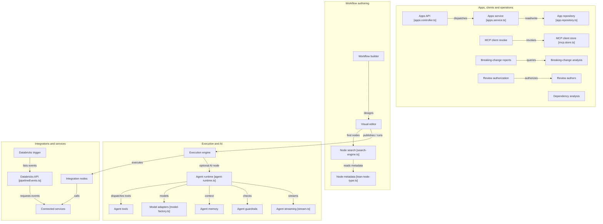

</details>


## 2.5 Agency Agents — specialist-role and team catalog

A library of specialist instructions and team templates rather than a mandatory independently running multi-agent service. Its roster includes research, creative, specialist, business and engineering roles. Team runbooks, an installer, a format converter, and Hermes router-related tooling help distribute those roles to existing assistants. In the merged system role definitions become versioned planner inputs.


[Open as PNG](diagrams/05_agency_agents.png) · [Editable Graphviz DOT](diagrams/05_agency_agents.dot) · [Editable Mermaid source](diagrams/05_agency_agents.mmd) · [Original supplied diagram](originals/AgencyAgents.png)

<details>
<summary>Show the original agency agents source diagram</summary>


</details>

### Original components and how each is retained

| Original box / filename | Role inside original diagram | Responsibility in unified system |
|---|---|---|
| **User / planner**  <br>*Role selection and teams* | Selects specialist skills, examples and teams. | The planner selects roles by explicit task requirement. |
| **Runbook teams**  <br>*Role selection and teams* | Preconfigured team combinations for recurring work. | Convert to versioned task-team templates. |
| **Workflow examples**  <br>*Role selection and teams* | Reference sequences and outputs for combined specialists. | Use as examples, not execution authority. |
| **Research agents**  <br>*Specialist roster* | Specialists for discovery, evidence examination, research strategy. | Use for research plans, retrieval verification and synthesis. |
| **Creative agents**  <br>*Specialist roster* | Specialists for design and creative outputs. | Use for content/design assignments with dedicated review criteria. |
| **Specialist agents**  <br>*Specialist roster* | Domain-specific experts outside core research/engineering categories. | Select when task domain warrants specialization. |
| **Business agents**  <br>*Specialist roster* | Specialists for strategy, operations, finance and commercial work. | Combine with OpenBB structured data when appropriate. |
| **Engineering agents**  <br>*Specialist roster* | Specialists for architecture, implementation, debugging and testing. | Combine with codebase-memory-mcp and REA capabilities. |
| **Hermes plugin builder**  <br>*Installation and conversion tools* | Collects a roster and generates a Hermes-oriented router integration. | Optional export; not the unified authoritative task router. |
| **Agent installer [install.sh]**  <br>*Installation and conversion tools* | Installs or registers role definitions for supported tools. | Use for setup; avoid modifying active runtime during a task. |
| **Format converter [convert.sh]**  <br>*Installation and conversion tools* | Transforms specialist definition formats for consumers. | Compile roles to canonical metadata and target-specific prompts. |
| **Hermes router**  <br>*Assistant integrations* | Routes compatible assistant invocations to registered specialists. | Optional client integration; gateway retains task control. |
| **Integration guides**  <br>*Assistant integrations* | Describe how roles can be used by different assistants. | Use to build compatibility adapters and validation tests. |
| **AI assistants**  <br>*Assistant integrations* | Runtime consumers of specialist definitions. | AgenticSeek is the principal runtime consumer in this design. |

### End-to-end internal path

1. The catalog divides specialist profiles into research, creative, other specialists, business and engineering. The supplied overview is a category map, not a list of separately executing model services.
2. Users can choose individual roles or consult prebuilt runbook teams and workflow examples. Team selection suggests complementary responsibilities and review stages.
3. A plugin builder collects roles and may produce a Hermes router. The installer and format converter help put those definitions into multiple assistant ecosystems; integration guides describe how they are consumed.
4. Once a runtime imports a role, the runtime—not the role file—supplies its model calls, tool access, job state and permissions.

### Merger behavior

Build a **Role Registry** that parses profile files into `id`, `version`, `capabilities`, `system_instructions`, `inputs`, `expected_outputs`, `quality_checks`, and `allowed_tool_families`. When AgenticSeek chooses a plan, attach the smallest set of relevant role profiles and explicitly assign steps. A "researcher" does not acquire web permissions simply because the role text requests them. Avoid nested Hermes routing unless it is deliberately exposed as an optional client interface; otherwise it would duplicate AgenticSeek's task router.

**Boundary tests:** role update invalidates profile cache without modifying ongoing task versions; a role cannot expand permissions; identical role and model repeated under the same plan produce versioned comparisons; teammates have clear handoffs and no double owner of a step.

<details>
<summary>Editable Mermaid representation of this subsystem</summary>

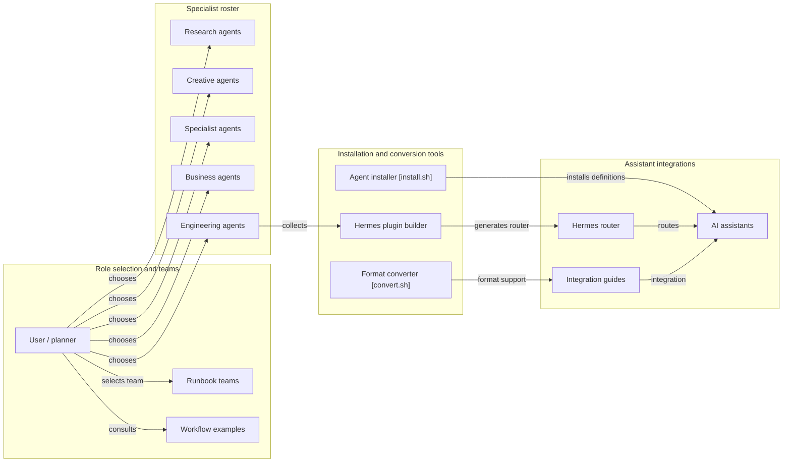

</details>


## 2.6 codebase-memory-mcp — source indexing and code graph

The repository understanding subsystem. Source files are indexed into a persistent SQLite-backed graph through language parsing, relation extraction, semantic resolution, infrastructure discovery and incremental repair. MCP tools and a graph UI query that graph. In the merged system this remains a separate project-index database whose evidence must be tied to repository identity, commit and index generation.


[Open as PNG](diagrams/06_codebase_memory.png) · [Editable Graphviz DOT](diagrams/06_codebase_memory.dot) · [Editable Mermaid source](diagrams/06_codebase_memory.mmd) · [Original supplied diagram](originals/MemoryMCP.png)

<details>
<summary>Show the original codebase memory source diagram</summary>


</details>

### Original components and how each is retained

| Original box / filename | Role inside original diagram | Responsibility in unified system |
|---|---|---|
| **Coding agent**  <br>*Graph UI and agent clients* | Requests repository indexing, graph search and analysis via MCP. | Invoke tools through the broker with repository scope. |
| **Graph UI [App.tsx]**  <br>*Graph UI and agent clients* | Renders visual graph interface. | Optional visual inspector for graph evidence. |
| **Graph explorer [GraphTab.tsx]**  <br>*Graph UI and agent clients* | Displays node and edge relationships. | Provides interactive drill-down for returned graph handles. |
| **UI RPC client [rpc.ts]**  <br>*Graph UI and agent clients* | Fetches graph UI data from service endpoints. | Is a presentation interface, not alternate graph storage. |
| **Client setup [agent_clients.c]**  <br>*MCP service and session runtime* | Registers/configures local MCP clients. | Use only to establish authorized endpoint access. |
| **MCP server [main.c]**  <br>*MCP service and session runtime* | Provides tool endpoints for indexing and analysis. | Main integration interface for agent tools. |
| **Session daemon [application.c]**  <br>*MCP service and session runtime* | Owns local background session and indexing workers. | Coordinate index lifecycle, not platform task state. |
| **Index pipeline [pipeline.c]**  <br>*Multi-pass indexing* | Orchestrates passes over project files and metadata. | Run as limited job; record index generation and path scope. |
| **Language parsers**  <br>*Multi-pass indexing* | Parse supported source languages into structural elements. | Provide syntax evidence per indexed file. |
| **Graph extraction [extract_unified.c]**  <br>*Multi-pass indexing* | Creates relationships across functions, references and modules. | Supply source location and edge type. |
| **Semantic resolution [lsp_all.c]**  <br>*Multi-pass indexing* | Resolves symbols and types using language-aware matching. | Flag ambiguous edges as inferred rather than certain. |
| **Infrastructure indexing [extract_k8s.c]**  <br>*Multi-pass indexing* | Indexes Kubernetes and deployment/configuration relationships. | Useful for tracing runtime dependencies and service boundaries. |
| **Incremental repair**  <br>*Multi-pass indexing* | Chooses reindex path after source changes. | Avoid full reindex when a bounded repair is valid. |
| **Delta staging [pipeline_delta.c]**  <br>*Multi-pass indexing* | Stages incremental graph patches before persistence. | Make graph updates atomic and generation-visible. |
| **Project source**  <br>*Graph storage and analysis* | Repository files, manifests and selected docs. | Bind source identity to git commit and indexed root. |
| **MCP analysis tools [main.c]**  <br>*Graph storage and analysis* | Queries graph links and impact data for clients. | Return bounded neighborhoods and source locators. |
| **Service linking [service_patterns.c]**  <br>*Graph storage and analysis* | Classifies service-to-service relationships. | Helpful for cross-repository and topology analysis. |
| **Graph storage [sqlite_writer.c]**  <br>*Graph storage and analysis* | Persists code entities/edges in SQLite-backed local storage. | Retain source-index ownership and provenance in this service. |

### End-to-end internal path

1. A coding agent or graph UI connects to the MCP service. Client registration sets up the local connection. Graph UI components use an RPC client to request data and render neighborhoods.
2. The session daemon or MCP action starts the index pipeline. It reads repository source files, manifests and supported infrastructure descriptions.
3. Language parsers identify syntax entities; unified graph extraction relates functions/modules/references; semantic resolution narrows ambiguous symbols; infrastructure indexing detects deployment and service relationships.
4. The incremental repair path stages deltas when files change instead of unnecessarily rebuilding the entire index. All successful work updates the service-owned SQLite graph store.
5. MCP analysis tools query the graph, classify service links and return source-linked relationships. Graph explorer and analysis clients consume these results, but UI render limits are not evidence that unseen nodes do not exist.

### Merger behavior

Expose `codegraph.index`, `codegraph.find`, `codegraph.trace`, `codegraph.impact`, `codegraph.service_links`, and `codegraph.freshness` through the broker, mapped to actual supported tools at the pinned version. Record source root, repository identity, **git commit**, ignored paths, index generation and completeness diagnostics. A code agent should request a bounded relevant subgraph and read exact source ranges before editing. REA may supply additional binary or runtime evidence, but it should not silently mutate this source graph; link both results at the evidence layer.

**Boundary tests:** indexes built from different commits are not conflated; an incremental update either commits or remains staged; excluded files are reported; large repository queries are bounded; source ranges match the indexed commit.

<details>
<summary>Editable Mermaid representation of this subsystem</summary>

```mermaid
flowchart TB
    subgraph ui["Graph UI and agent clients"]
      agent["Coding agent"]
      ui["Graph UI [App.tsx]"]
      explore["Graph explorer [GraphTab.tsx]"]
      rpc["UI RPC client [rpc.ts]"]
    end
    subgraph daemon["MCP service and session runtime"]
      clients["Client setup [agent_clients.c]"]
      mcp["MCP server [main.c]"]
      daemon["Session daemon [application.c]"]
    end
    subgraph pipeline["Multi-pass indexing"]
      pipe["Index pipeline [pipeline.c]"]
      parse["Language parsers"]
      extract["Graph extraction [extract_unified.c]"]
      semantic["Semantic resolution [lsp_all.c]"]
      infra["Infrastructure indexing [extract_k8s.c]"]
      repair["Incremental repair"]
      delta["Delta staging [pipeline_delta.c]"]
    end
    subgraph graph["Graph storage and analysis"]
      source["Project source"]
      tool["MCP analysis tools [main.c]"]
      patterns["Service linking [service_patterns.c]"]
      storage["Graph storage [sqlite_writer.c]"]
    end
    agent -->|"requests tools"| mcp
    clients -->|"connects"| mcp
    ui -->|"renders graph"| explore
    ui -->|"requests UI data"| rpc
    rpc -->|"queries"| mcp
    daemon -->|"starts workers"| pipe
    mcp -->|"dispatches indexing"| pipe
    pipe -->|"parses"| parse
    pipe -->|"extracts structure"| extract
    pipe -->|"resolves"| semantic
    pipe -->|"indexes config"| infra
    pipe -->|"selects reindex"| repair
    repair -->|"stages"| delta
    source -->|"reads files"| pipe
    pipe -->|"writes graph"| storage
    delta -->|"patches graph"| storage
    mcp -->|"dispatches analysis"| tool
    tool -->|"classifies"| patterns
    tool -->|"queries"| storage
    patterns -->|"queries"| storage
```

</details>


## 2.7 REA — reverse engineering and evidence collection

The bounded binary/application inspection subsystem. It exposes CLI and MCP routes over a shared reverse-engineering service, composes available analysis providers, manages provider processes and sessions, and delivers evidence with failures and provenance. It is complementary to source-code indexing and should be isolated with explicit target authorization.


[Open as PNG](diagrams/07_rea.png) · [Editable Graphviz DOT](diagrams/07_rea.dot) · [Editable Mermaid source](diagrams/07_rea.mmd) · [Original supplied diagram](originals/REA.png)

<details>
<summary>Show the original rea source diagram</summary>


</details>

### Original components and how each is retained

| Original box / filename | Role inside original diagram | Responsibility in unified system |
|---|---|---|
| **Engineer or agent**  <br>*Analysis interfaces* | Requests investigation or runs REA commands. | Supply target authorization and immutable artifact identity. |
| **MCP server [main.ts]**  <br>*Analysis interfaces* | Advertises analysis tools to MCP clients. | Main agent-side integration through tool broker. |
| **Reverse CLI**  <br>*Analysis interfaces* | Executes commands for investigation and diagnostics. | Use in trusted admin sessions and bounded scripts. |
| **Analysis tool registration**  <br>*Analysis interfaces* | Declares which capabilities the MCP server exposes. | Check installed provider availability before advertising tools. |
| **Tool contracts**  <br>*Analysis orchestration* | Schemas and expected behavior of analysis operations. | Map exact versions into broker tool registry. |
| **Provider composition**  <br>*Analysis orchestration* | Builds the analysis service using configured providers. | Use installed-provider health and capability checks. |
| **Reverse-engineering service**  <br>*Analysis orchestration* | Dispatches analysis to providers and merges results. | Treat as owner of internal analysis sessions. |
| **Provider process runtime [ProviderProcess.ts]**  <br>*Runtime and evidence* | Owns external tool processes, deadlines, cancellation and cleanup. | Constrain CPU/memory, local filesystem and subprocess effects. |
| **Analysis errors**  <br>*Runtime and evidence* | Represents failures from providers and analysis calls. | Preserve typed failures rather than invent missing findings. |
| **Coverage service**  <br>*Runtime and evidence* | Measures which code or behavior was actually inspected. | Identify analysis gaps in delivered report. |
| **Evidence model [evidence.ts]**  <br>*Runtime and evidence* | Records findings and source observations. | Store findings by target hash, method and offset. |
| **Error projection**  <br>*Runtime and evidence* | Normalizes failures for callers. | Tie failure details to each attempted step and provider. |
| **GDB sessions**  <br>*Native and application analysis providers* | Debugging sessions for authorized Linux targets. | Separate active runtime observation from static analysis. |
| **Ghidra analysis [GhidraClient.ts]**  <br>*Native and application analysis providers* | Native binary analysis/decompilation using external Ghidra. | Use caller-installed provider with isolated projects. |
| **Rizin sessions**  <br>*Native and application analysis providers* | Disassembly and analysis through external Rizin tooling. | Record exact provider and command sequence. |
| **Cutter analysis**  <br>*Native and application analysis providers* | Cutter / Rizin-associated analysis capabilities. | Treat as optional provider interface. |
| **Android analysis [JadxAnalysis.ts]**  <br>*Native and application analysis providers* | Analyzes APKs and Android code. | Require JADX availability and target scope. |
| **JADX bridge [RealJadxBridge.java]**  <br>*Native and application analysis providers* | Bridges Java analysis tooling for Android. | Keep it in a provider-specific process/container. |
| **Hopper analysis [HopperClient.ts]**  <br>*Native and application analysis providers* | Uses caller-supplied Hopper capabilities. | Optional licensed provider; avoid assumptions of availability. |
| **Kuna analysis**  <br>*Native and application analysis providers* | Uses configured Kuna analysis tooling where available. | Optional analysis route; report provider-specific limits. |
| **IDA analysis**  <br>*Native and application analysis providers* | Uses configured IDA provider where available. | Optional licensed provider with separate license conditions. |
| **JavaScript analysis**  <br>*Native and application analysis providers* | Examines JavaScript/Electron modules, imports and runtime links. | Potential bridge to codebase graph for recovered sources. |
| **JavaScript worker**  <br>*Native and application analysis providers* | Runs JS analysis jobs in a controlled worker. | Isolate untrusted code files and bound resource usage. |
| **Browser scenarios**  <br>*Native and application analysis providers* | Defines repeatable browser interactions for runtime investigation. | Require explicit scope when actions interact with real accounts. |
| **Browser capture**  <br>*Native and application analysis providers* | Captures page, network or execution observations. | Persist recordings/screenshots as evidence snapshots. |

### End-to-end internal path

1. An engineer/agent enters through CLI or MCP. Analysis-tool registration and contracts describe the exposed operations; provider composition selects which installed engines are available.
2. The shared reverse-engineering service dispatches an inspection request to native tools (Ghidra, Rizin, Cutter, Hopper, IDA, Kuna), debugger sessions (GDB), Android tooling (JADX and its Java bridge), or JavaScript/browser-analysis workers depending on target and available dependencies.
3. The provider process runtime supervises external processes and sessions, sets deadlines, owns cancellation/cleanup and captures failures. Distinguish static examination from runtime execution—the latter has materially different side effects.
4. Browser scenarios and captures record dynamic observations; JavaScript workers analyze application structure; Android tools produce classes/methods/resources; binary providers return offsets, disassembly and decompilation where supported.
5. The coverage service, error projection and evidence model annotate results so a reviewer can determine what was actually inspected, what failed, and which claim came from which provider and target.

### Merger behavior

Expose discovered `rea.inspect`, `rea.decompile`, `rea.references`, `rea.runtime_capture`, and `rea.export_evidence` through a provider-aware adapter. Require the exact target artifact hash, declared target type, authorized file path, permitted analysis mode and provider requirements. Run REA in a container or sandbox with read-only target mounts by default; enable runtime capture with specific approval and without reuse of unrelated credentials. Treat uncovered or unsupported regions as explicit unknowns. Feed source-level relationships recovered from binaries into the evidence graph as *linked observations*, not as authoritative source-graph rewrites.

**Boundary tests:** unavailable Ghidra/JADX/IDA provider yields a clear capability error; provider crash yields a receipt; session cancellation stops dependent work; a target hash mismatch is rejected; read-only inspection does not alter the target.

<details>
<summary>Editable Mermaid representation of this subsystem</summary>

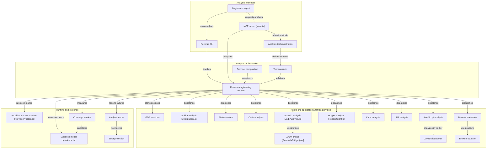

</details>

---

# 3. Required integration components


[Scalable SVG](diagrams/08_integration_control_plane.svg) · [Editable Graphviz](diagrams/08_integration_control_plane.dot) · [Editable Mermaid](diagrams/08_integration_control_plane.mmd)

**Read this diagram left to right:** requests enter through the gateway; policy and ledger establish one authoritative task identity; AgenticSeek uses Agency Agents roles and shared model inference to plan; the capability broker dispatches only authorized typed tool calls; specialist results become provenance-bearing artifacts; the verifier constructs outputs and writes receipts to the ledger. The broken/dotted edges denote profile/model input or authorization/receipt checks, not competing workflow authority.


These are **new platform components**. The seven source systems do not collectively supply them as one ready-made package.

## 3.1 Unified gateway and identity

The gateway is the only front door for external or UI-originated AI tasks. It authenticates a caller, attaches tenant/project/workspace scope, converts instructions and attachments to an immutable task envelope, evaluates admission rules, stores the task, and returns a stable ID. A client can stream status, ask for approval, cancel or fetch artifacts. n8n uses the same API with a service account and a caller-supplied idempotency key.

**Recommended endpoints** (proposed; these are not upstream endpoints): `POST /v1/tasks`; `GET /v1/tasks/{id}`; `GET /v1/tasks/{id}/events`; `POST /v1/tasks/{id}/approve`; `POST /v1/tasks/{id}/cancel`; `GET /v1/tasks/{id}/artifacts`; `POST /v1/automation/callbacks`. Use signed callback payloads, webhook replay detection and strict project authorization.

## 3.2 Durable ledger and step scheduler

The ledger tracks task ID, plan revision, step DAG, step input hash, attempt ID, tool call identity, authorization record, started/finished time, receipt URI, cancellation and final result. Store it transactionally (e.g. PostgreSQL), separate from n8n's DB, the code graph SQLite DB and conversation memory. A scheduler admits ready DAG nodes only after dependencies have completed and policy permits them. A task can have many independent ready nodes; this is **tool parallelism**, not unrestricted simultaneous LLM calls.

**Key invariant:** once a side-effecting step has a committed success receipt, retries return the existing receipt rather than repeating the action. For an operation that cannot prove exactly-once execution, use idempotency keys or a reconcile-before-retry policy.

## 3.3 Policy and approval service

Authorization is defined by caller identity, project scope, target resources, action type and approval requirements. Example grants: `web.read.public`, `data.market.read`, `repo.read`, `workspace.write.sandbox`, `binary.inspect.static`, `binary.execute.authorized`, `external.notification.send`, `external.account.modify`, `model.infer`, `task.approve`, and `task.cancel`. Task-control grants (`task.approve`, `task.cancel`) are distinct from tool grants. Do not infer grants from agent role text or website data. Evaluate both **at planning** and **immediately before a tool executes**. Runtime/binary analysis, shell execution, external account changes and credential-bearing browser interaction should have separate scoped authorities.

## 3.4 Capability broker and adapter registry

The broker inventories available tools and translates between a stable internal call envelope and each upstream transport: MCP stdio/Streamable HTTP, typed REST, Python function calls, and sandboxed subprocesses. Each adapter declares its actual installed tool names, request/result schema, side-effect class, health, resource cost and required permissions. One registry entry may represent many backend operations but cannot claim a capability whose dependency is missing.

**Avoid false uniformity:** OpenBB returns typed series/tables, Scrapling returns captured pages and extracted records, codebase-memory-mcp returns graph nodes/edges, REA returns traceable binary findings, and n8n returns workflow executions. Normalize status and provenance while preserving their native payload types.

## 3.5 Specialist role registry and planner adapter

Parse Agency Agents definitions into immutable versioned role profiles, then offer them to AgenticSeek as planner-selectable instructions and review rubrics. The role registry answers questions like "which specialist should inspect data quality?" and "which reviewer should independently verify the code patch?" The planner creates a DAG with assigned responsibilities. The role file **never** directly authorizes new tools.

## 3.6 Model router and GPU admission

Maintain one inference entry point that supports local model endpoints and optional externally hosted providers. Publish model context size, supported modalities, output capability, tokens-per-second and estimated cost as routable metadata. Bound simultaneous heavyweight generations by observed GPU capacity. A swarm can fetch pages, run static parsing, build graphs and process structured datasets in parallel while only one or a few bounded model generations run. Batch and reuse deterministic preprocessing; cache immutable data keyed by input hash and tool version.

## 3.7 Evidence, artifacts and unified retrieval

Evidence stores raw bytes or canonical snapshots together with `source_id`, originating tool, timestamp, scope, content hash and a precise locator (URL/selector, dataset key/time range, repo commit/file/line, binary hash/offset, or workflow execution ID). The retrieval service returns **short excerpts + source handles**. Results always distinguish observed data from model inference. Citation assembly uses source IDs and locators, not merely prose references. Source text remains untrusted; the model may analyze it, but the policy service will not execute instructions embedded in fetched pages or binaries.

## 3.8 Result verification and delivery

Validation varies by task: compare market series units and dates, check scraped fields against snapshots, verify repository files against the indexed commit, or validate binary offsets and provider versions. For code changes, include diff and test receipts. The final assembler provides an executive answer and attachable artifact bundle, with explicit contradictions, failures and uninspected coverage. Delivery is then made through the user interface or n8n's approved integration nodes.

## 3.9 Required data-flow separation

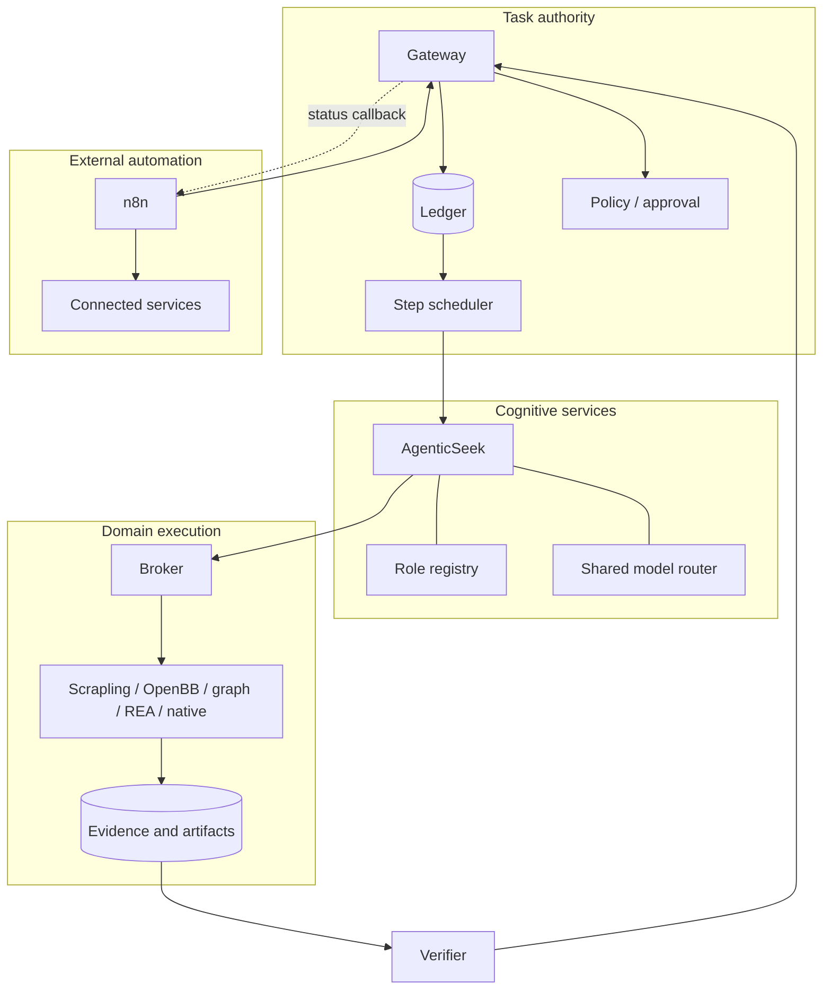

---

# 4. Cross-system execution examples

## 4.1 Research and structured-data investigation

**Goal:** compare organizations or market developments using published pages and validated data series.

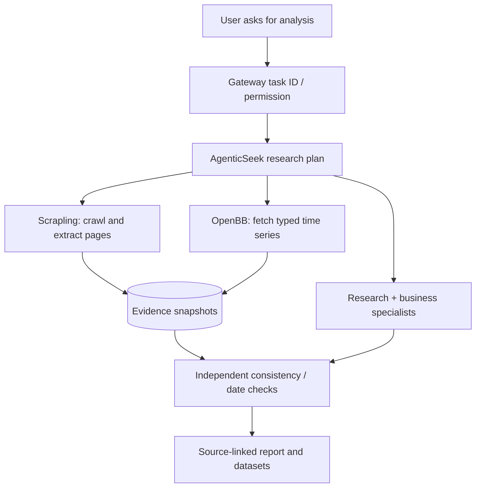

**Detailed sequence:** (1) define entities, regions, periods and comparison methods; (2) choose a research lead, data specialist and verifier; (3) dispatch web acquisition and OpenBB queries concurrently; (4) save captured pages, data tables, provider/version metadata and retrieval times; (5) crosswalk sources by entity and time; (6) independently check numbers and dates; (7) draft the report with exact evidence locators; (8) return the report and optional CSV/JSON. **Do not** conflate a website claim with a provider-backed series simply because both contain the same label.

## 4.2 Repository change and implementation

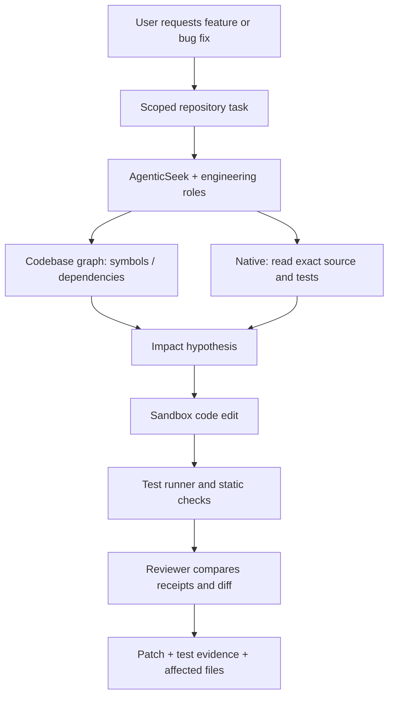

**Detailed sequence:** verify project commit, index generation and permitted worktree; find entry points and dependent modules; request precise file ranges; form an implementation plan with tests; modify an isolated worktree; run bounded tests and lint checks; reindex modified files; compare changed relations to the planned impact; return a diff and reproducible receipts. REA can join when a dependency is binary-only or application behavior must be observed.

## 4.3 Application or binary investigation

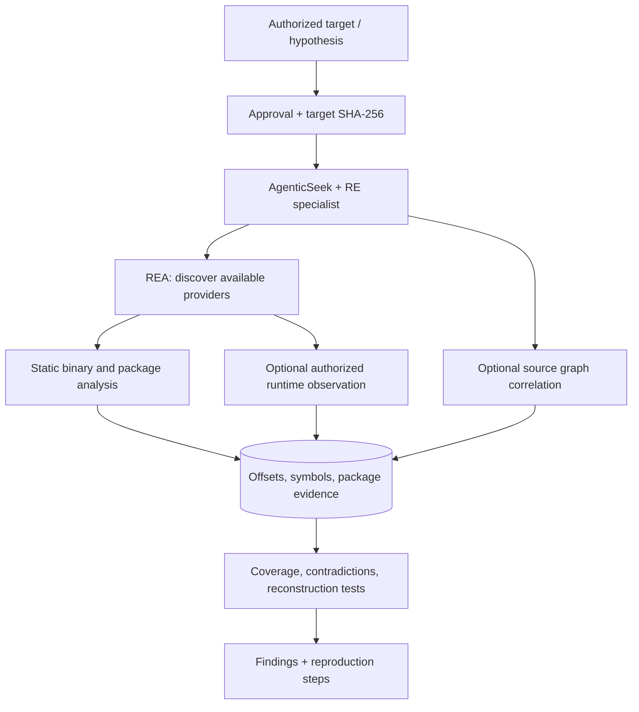

**Detailed sequence:** record immutable binary/package identity and scope; inspect static structure first; choose providers with proven availability; trace selected functions/assemblies, or browser/Android/Electron behavior where relevant; keep runtime operations separate and explicitly authorized; retain snapshots and provider errors; correlate with source graph only when valid corresponding source exists; reconstruct a hypothesis and test it; report observed facts, reasoned deductions and coverage limits separately.

## 4.4 Scheduled intelligence monitoring and notification

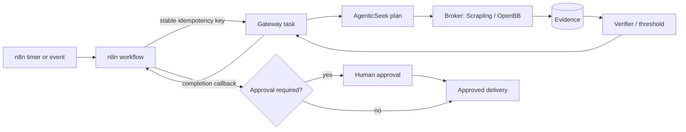

**Detailed sequence:** n8n notices a trigger, prepares the task key and submits a request. The gateway admits and deduplicates it, then produces a data-backed result. A signed callback returns outcome and artifact references. n8n uses configured conditions and approval steps to notify a user, update an external system or schedule another run. A repeated trigger can recheck a completed task without repeating its already committed side effects.

## 4.5 Parallelism: useful swarm vs wasteful model duplication

Parallelize I/O-bound, CPU-bound and independent operations: page retrieval, document parsing, AST extraction, code-graph queries, dataset downloading and offline binary metadata inspection. Bound CPU/memory/network separately. Use a DAG scheduler to run only independent ready steps. LLM-heavy workers share a **model queue and context budget**, and their reviews should operate on summarized evidence handles rather than repeated full document dumps.

| Work | Best concurrency approach | Reason |
|---|---|---|
| Many static web pages | Parallel Scrapling fetchers with per-host limits | Mostly network-bound; extraction is deterministic |
| Typed OpenBB provider queries | Parallel per provider and bounded rate limits | Independent data requests, source-specific quotas |
| Code graph indexing | Dedicated CPU/memory worker with controlled reindexing | High local CPU/RAM, writes shared graph generation |
| REA providers | Separate process slots, bounded target/session lifetimes | Native tools may be CPU/memory heavy and stateful |
| Multiple specialists using one GPU | Queue/limited parallel model generation | Avoid memory thrash and repeated prompt context |
| n8n triggers and notifications | Durable workflow concurrency with dedupe | External effects need reliable execution receipts |

---

# 5. Contracts, reliability, and deployment

## 5.1 Canonical task envelope (proposed)

```json
{
  "task_id": "T-00042",
  "idempotency_key": "caller-unique-stable-key",
  "project_id": "project-alpha",
  "request": { "intent": "analyze", "instructions": "Compare the provided sources" },
  "inputs": [{ "artifact_uri": "artifact://inputs/sha256/abcd...", "kind": "document" }],
  "permissions": ["web.read.public", "data.market.read", "repo.read"],
  "budgets": { "model_calls": 12, "tool_calls": 30, "time_seconds": 600 },
  "delivery": { "format": "report_with_evidence" }
}
```

`task_id` is returned by the gateway and never re-generated by a retry. Permission lists are issued/validated by policy; callers can request a capability but cannot grant it. The stable key must have an explicit scope (caller/project) and retention policy.

## 5.2 A typed tool call, including attempt identity

```json
{
  "task_id": "T-00042",
  "step_id": "S-005",
  "attempt_id": "A-001",
  "tool": "scrapling.fetch",
  "schema_version": "1",
  "args": { "url": "https://example.org/public-report", "extract": { "selector": "main" } },
  "permissions_used": ["web.read.public"],
  "deadline_ms": 45000,
  "idempotency_key": "T-00042:S-005",
  "read_only": true
}
```

Step identity differs from attempt identity: a retry may create a new attempt record while retaining the logical step key. Read-only tool calls may be retried under policy; external side effects need idempotency or reconciliation.

## 5.3 Typed result with evidence, artifact and failure channels

```json
{
  "task_id": "T-00042",
  "step_id": "S-005",
  "attempt_id": "A-001",
  "status": "succeeded",
  "result_type": "web.extract.v1",
  "summary": "Two requested sections extracted",
  "data": { "title": "Public Report", "section_count": 2 },
  "artifacts": [
    { "uri": "artifact://T-00042/S-005/page.html", "sha256": "<full SHA-256>" }
  ],
  "evidence": [
    { "source_uri": "https://example.org/public-report", "locator": "css:main", "captured_at": "2026-11-06T21:00:00Z" }
  ],
  "errors": [],
  "usage": { "elapsed_ms": 1840, "model_tokens": 0 }
}
```

**Interpretation:** a successful transport response does not mean the factual content is verified. A tool receipt proves what the tool reported and points to immutable material; the verifier must separately evaluate whether it supports the requested claim.

## 5.4 State machine and retries

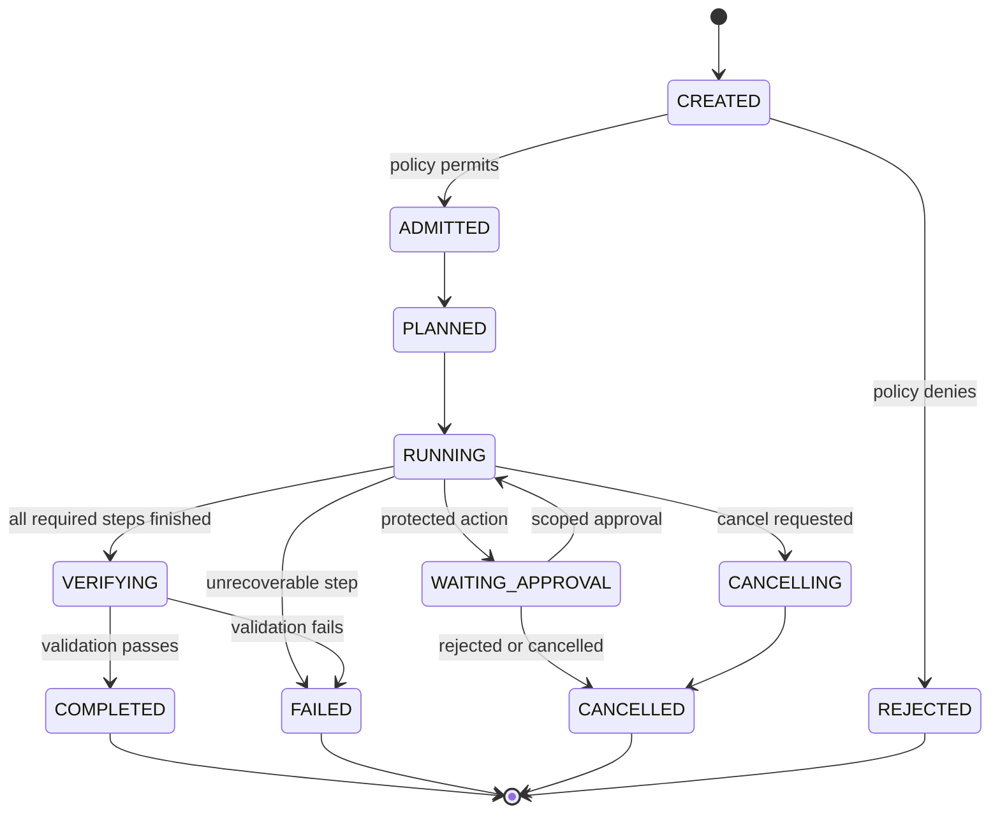

No undocumented transition should move a failed run directly to completed. Retries should attach to the same task and logical step. On crash recovery, reconcile any externally launched action before issuing another operation. Persist step receipts before releasing downstream dependencies.

## 5.5 Artifact and provenance schemas

| Evidence class | Required locator | Freshness / identity checks |
|---|---|---|
| Website page | Original URL, final URL, selector/DOM or text offsets, retrieval time, capture hash | Redirect, response, crawl session and capture version |
| OpenBB series | Provider, exact command/args, symbol/series, start/end, unit, time zone, fetch time | Provider release, missing observations, adjusted/unadjusted basis |
| Code source | Project/repo ID, commit, file, line span, index generation, content hash | Index corresponds to exact commit and file bytes |
| Binary/application | Target SHA-256, platform/format, offset or symbol, provider version, analysis session | Target stable, provider available, static vs dynamic separated |
| n8n execution | Workflow ID/version, execution ID, node/action, trigger event ID | Replay detection, complete external-action receipt |
| Model synthesis | Prompt/template versions, model/backend ID, input evidence references, completion ID | Distinguish generated inference from observed evidence |

## 5.6 Deployment layout and service isolation

```text
unified-platform/
  gateway/                  # authentication, task API, admission and streaming
  scheduler/                # DAG scheduling and worker recovery
  ledger/                   # task DB migrations, receipts and audits
  policy/                   # grants, side-effect classes and approvals
  role-registry/            # immutable Agency Agents profile conversions
  agenticseek-adapter/      # planning / base Tool bridge
  model-router/             # shared inference scheduling
  broker/                   # tool registry, transport adapters, normalization
  adapters/
    scrapling/
    openbb/
    codebase-memory/
    rea/
    native/
    n8n/
  evidence/                 # snapshots, hashes, source locators, exports
  verifier/                 # task-specific cross-checking and result assembly
  ui/                       # optional unified interface
  deploy/                   # Compose, secrets references, sandbox policies
  tests/                    # contracts, restart, recovery, and end-to-end
```

The paths above are **suggested for new integration code**, not asserted upstream repository paths. Keep the seven projects as version-pinned standalone dependencies/services. Start on a single host with isolated service containers/processes. Use separate service accounts and writable volumes. Expose only the gateway to user networks; keep databases, worker APIs and local model servers behind internal access controls. Use a persistent artifact root and automated backups.

## 5.7 Service-to-service connections

| Caller | Callee | Recommended transport | Identity and state coupling |
|---|---|---|---|
| UI / CLI / voice | Gateway | Authenticated HTTP, SSE or WebSocket | Session ID ↔ task ID |
| n8n workflow | Gateway | HTTPS REST + signed callback/webhook | n8n execution ID ↔ stable task key |
| Gateway scheduler | AgenticSeek adapter | Internal RPC or queued job | task ID + plan revision |
| AgenticSeek adapter | Model router | OpenAI-compatible or native model API | task/step budgets and model ID |
| AgenticSeek adapter | Broker | Internal typed RPC | caller-issued scoped tool identity |
| Broker | Scrapling | MCP or isolated worker RPC | crawl ID + capture IDs |
| Broker | OpenBB | MCP, REST or Python adapter | provider+query+result hash |
| Broker | codebase-memory-mcp | MCP | project+commit+index generation |
| Broker | REA | MCP/CLI subprocess adapter | target hash+analysis session ID |
| Broker | Native tool worker | Sandboxed commands | workspace+file hashes+exit receipt |
| All domain adapters | Artifact store | Internal object or file API | immutable content hash and URI |
| Verifier | Ledger + evidence retrieval | Read-only internal API | exact task/step/receipt mapping |

## 5.8 Security, resource control and common failure cases

- **Untrusted material:** web pages, repository docs, files, returned tool text and binary strings are data; do not allow them to create new authorization rules or override planner policy.
- **Credential separation:** browser profiles, OpenBB provider tokens, n8n credentials, REA vendor installations and model service keys remain local to their owners. Do not publish them to prompt context.
- **Network segmentation:** distinguish public-web retrieval, provider APIs, local private data, and external write operations. Fail closed if a required permission is missing.
- **Path isolation:** file and REA workers operate on declared roots or immutable input artifacts. Treat symlinks and path traversal as security-sensitive.
- **Provenance under failures:** partial crawls, incomplete data series, stale code indexes, absent providers, native-tool crashes and timed-out notifications must remain visible in receipts.
- **CPU/GPU/RAM:** tool and inference concurrency are separate queues; establish limits per worker class and stop work when budgets expire.
- **License/compliance:** review pinned upstream licenses and dependencies before redistribution or providing a hosted service; n8n licensing deserves dedicated attention.

## 5.9 Phased build and acceptance criteria

| Phase | Build work | Acceptance evidence |
|---|---|---|
| 0 · Baseline | Pin upstream commits, dependency versions, licenses, and available tool inventories. | Reproducible installation manifest and service health snapshots. |
| 1 · Core | Gateway, task API, policy, ledger, artifact store, simple scheduler. | A task ID survives restart; duplicate request deduplicates; artifacts have hashes. |
| 2 · Planning | AgenticSeek adapter, Agency Agents loader, shared model backend. | One approved plan executes a mock tool without privilege expansion. |
| 3 · Web/data | Scrapling and OpenBB adapters. | One real page capture and one typed provider dataset with source locators. |
| 4 · Software intelligence | codebase-memory-mcp and REA adapters. | Indexed repo and authorized static binary analysis return queryable receipts. |
| 5 · Automation | n8n connector, signed callbacks, scoped approvals and retries. | Duplicate trigger does not duplicate task or completed external action. |
| 6 · Qualification | Cross-system tests, failure recovery, security checks, metrics. | All four workflows in Chapter 4 pass, including cancellation and restart tests. |

### Priority implementation decisions

1. Build a **narrow typed gateway and broker** before inventing additional autonomous agents.
2. Make **idempotency and provenance first-class** from the first executable vertical slice.
3. Prefer **supported upstream interfaces** (MCP/REST/Python) to large forks; verify exact APIs on the pinned versions.
4. Begin with **one complete vertical slice** (`user -> planner -> Scrapling -> evidence -> verifier -> report`), then integrate additional tools.
5. Start with a **single-host runtime** to expose integration flaws early; distribute only after measured resource constraints justify it.
6. Evaluate effectiveness by **validated task completion, wall-clock time, model token consumption, resource use, error rate and recoverability**, not by the number of specialist processes launched.

## 5.10 Minimal end-to-end acceptance suite

| Test | Expected result |
|---|---|
| Submit identical request twice with the same idempotency key | One task ID; no duplicate execution |
| Attempt unapproved write through a specialist instruction | Denied before tool call |
| Parallel web/data operations finish in different order | Same dependency-correct result |
| Restart after external action commits but before response delivery | Recovery finds the receipt; does not repeat action |
| Cancel a long-running Scrapling crawl | Worker stops; partial evidence and cancellation state are retained |
| Query a code graph indexed at an older commit | Staleness reported; no invented current-line attribution |
| Invoke REA without required analysis provider | Explicit unsupported/unavailable result |
| Inject model instructions into captured HTML | Content treated as evidence only; policy unchanged |
| Force model backend overload | Requests queue or fail gracefully with resource receipt |
| n8n webhook repeats after timeout | Same gateway task; no duplicate approved notification |
| Produce a report with intentionally conflicting sources | Conflicts surfaced and traceable to individual evidence IDs |

---

# 6. Traceability, original sources, and file layout

## 6.1 What is existing versus proposed

**Existing in source diagrams:** individual modules and workflows described within each original repository. **Proposed integration work:** unified gateway, identity and policy, durable ledger, broker/adapter registry, profile compiler, evidence normalization, result verifier, model admission and cross-service correlation. Some upstream repositories already implement portions of these functions internally; those internal features are not substitutes for one shared cross-system contract.

## 6.2 Sources and caveats

- AgenticSeek: https://github.com/Fosowl/agenticSeek — planning, browser/code/file agents, local inference, CLI/web/API.
- Scrapling: https://github.com/D4Vinci/Scrapling — spiders, fetchers, adaptive extraction, session handling, CLI and MCP.
- OpenBB: https://github.com/openbq-org/OpenBB — modular provider/router infrastructure, typed Python API, REST and MCP (depending on installed packages/extensions).
- n8n: https://github.com/n8n-io/n8n — workflow authoring, triggers, integrations, execution engine and AI nodes.
- Agency Agents: https://github.com/msitarzewski/agency-agents — reusable specialist definitions and team examples.
- codebase-memory-mcp: https://github.com/DeusData/codebase-memory-mcp — persistent graph, source indexing, MCP and graph UI.
- REA: https://github.com/morluto/rea — evidence-oriented application/binary/runtime inspection through CLI and MCP with optional external providers.

The original diagrams are snapshots; file names, internal architecture, supported providers and interfaces can change. Treat the component crosswalk as a faithful interpretation of the supplied pictures, and verify upstream exports/flags against exact commits during implementation. Nothing in this manual claims the seven projects already interoperate.

## 6.3 Package contents

```text
Unified_Agentic_System_Manual.md            # Full source Markdown
Unified_Agentic_System_Manual.html          # Fully offline browser-readable manual
README.txt                                 # Opening instructions
MANIFEST.json                              # File sizes and SHA-256

diagrams/
  00_unified_overview.svg/.png/.mmd
  01_agenticseek.svg/.png/.dot/.mmd
  02_scrapling.svg/.png/.dot/.mmd
  03_openbb.svg/.png/.dot/.mmd
  04_n8n.svg/.png/.dot/.mmd
  05_agency_agents.svg/.png/.dot/.mmd
  06_codebase_memory.svg/.png/.dot/.mmd
  07_rea.svg/.png/.dot/.mmd
  08_integration_control_plane.svg/.png/.dot/.mmd

originals/
  AgenticSeek.png, Scrapling.png, OpenBB.png, n8n.png,
  AgencyAgents.png, MemoryMCP.png, REA.png
```

**Rendering note:** Because Markdown renderers differ, SVG images and Mermaid source are both included. The standalone HTML embeds the SVG images so it does not depend on local paths or JavaScript services. Open the `.html` directly in a browser for the simplest full-color navigation. If you need a printable copy, use the browser print command from the standalone HTML.
